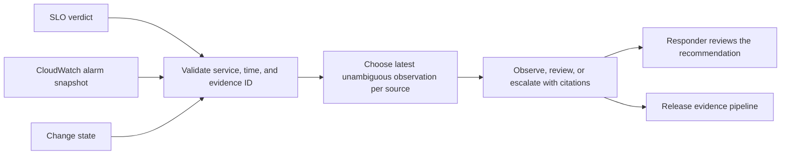

# Cloud On-call Evidence Agent

Read SLO, queue alarm, and change evidence and return a cited on-call recommendation. The agent uses explicit rules that can be replayed in tests.

## Business problem

An on-call responder often sees a page, an alarm, and a recent deploy together. A useful handoff needs the observations, their freshness, and a clear indication when the responder needs more evidence.

## Architecture



## Design and tools

The agent selects observations for the requested service and rejects old or future evidence. Conflicting observations at the same newest minute leave a gap. A paging SLO plus an alarm suggests queue escalation. A paging SLO plus a recent change suggests release investigation. Missing or uncertain evidence produces a review path.

**Stack** · Python, unittest, JSON observations, AWS CloudWatch, optional boto3 adapter

## Run the demo

Use Python 3.9 or later and Make from the repository root.

```sh
make verify
python3 agent.py examples/checkout.json
```

## Deployment

The optional collector reads one named AWS metric alarm using boto3 and `cloudwatch:DescribeAlarms`. Install boto3 in a local virtual environment and run `python3 cloudwatch.py checkout-dlq checkout --region us-east-1` with a read-only AWS identity. Use Unix epoch minutes across all live sources when building the snapshot. Repeated alarm states with an old timestamp need review.

## Verification

Five tests passed for citations, stale or conflicting inputs, missing context, and the read-only CloudWatch adapter with a mocked client. The bundled fixture returned `escalate` on the queue-backlog route.

## Operating limits

The agent has no model or external tool executor. The AWS adapter was checked with a mock. Its output is advisory and it sends no pages or infrastructure changes.

[Architecture](docs/ARCHITECTURE.md) · [Case study](docs/CASE_STUDY.md) · [Troubleshooting](docs/TROUBLESHOOTING.md) · [Runbook](docs/RUNBOOK.md)

The [Release Evidence Pipeline](https://github.com/Klokesh493/release-evidence-pipeline) consumes this project's report in its integration demo.
