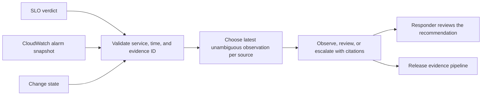

# Architecture

The agent selects observations for the requested service and rejects old or future evidence. Conflicting observations at the same newest minute leave a gap. A paging SLO plus an alarm suggests queue escalation. A paging SLO plus a recent change suggests release investigation. Missing or uncertain evidence produces a review path.

The optional collector reads one named AWS metric alarm using boto3 and `cloudwatch:DescribeAlarms`. Install boto3 in a local virtual environment and run `python3 cloudwatch.py checkout-dlq checkout --region us-east-1` with a read-only AWS identity. Use Unix epoch minutes across all live sources when building the snapshot. Repeated alarm states with an old timestamp need review.
